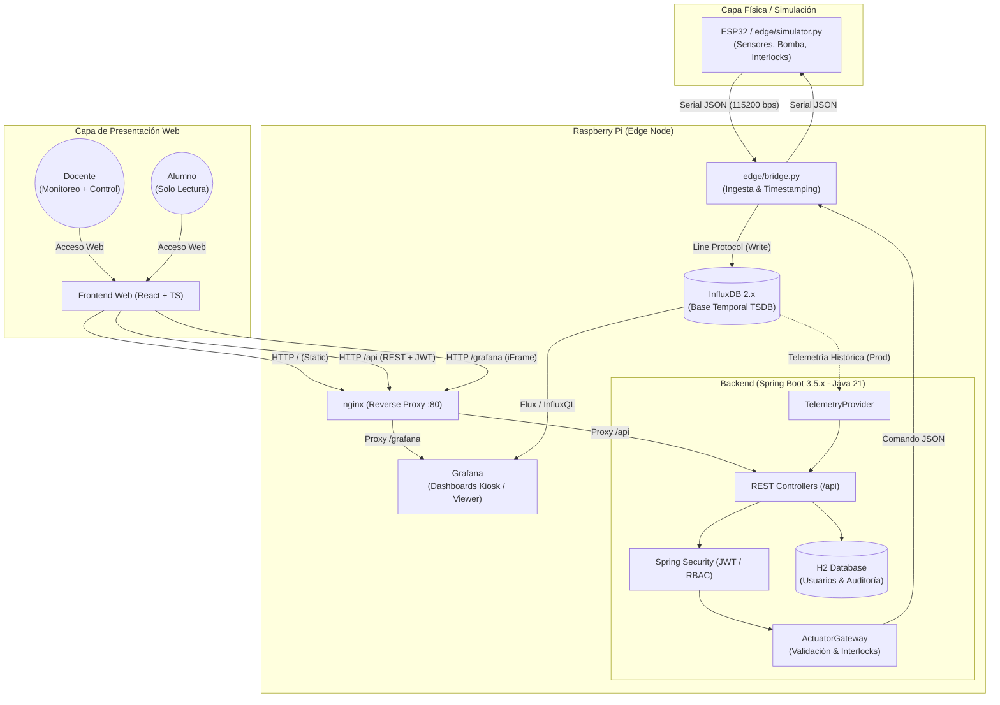

# Kit Didáctico de Tanques Interconectados (UTN FRSF / GITDA)

Sistema web integral de monitoreo en tiempo real y control seguro para el kit didáctico de tanques acoplados en serie, desarrollado en el marco de proyectos de Industria 4.0 e Internet de las Cosas (IoT) de la Universidad Tecnológica Nacional - Facultad Regional Santa Fe.

---

## 1. Arquitectura General del Sistema

La solución opera de forma autónoma en el borde (*Edge Computing*) sobre una Raspberry Pi, con un único punto de entrada HTTP expuesto mediante un reverse proxy **nginx**:



---

## 2. Delimitación de Alcance y Principios de Diseño

* **Plataforma Local (Edge Computing)**: El sistema completo se despliega en una Raspberry Pi sin depender de servicios en la nube.
* **Sin Placas Peltier (Estricto)**: El kit no cuenta con celdas termoeléctricas ni actuadores de control térmico activo. La temperatura registrada es exclusivamente de **monitoreo pasivo**.
* **Válvulas Manuales**: Las llaves de paso entre los tanques y hacia el reservorio son manuales. No existe sensado ni control automatizado de válvulas.
* **Interlocks de Seguridad**:
  * El único actuador gobernado es la bomba de impulsión (`pump`).
  * Posee corte por hardware/firmware autónomo y corte lógico en software si el nivel de cualquiera de los tanques supera el **85%** (configurable), protegiendo contra sobrellenado originado por la inercia de descarga de A hacia B.

---

## 3. Estado de Fases del Proyecto

| Fase | Descripción | Estado |
|---|---|:---:|
| **Fase 0** | Reglas de repositorio, contratos de datos, flujos de interlock y documentación base | **Completada** |
| **Fase 1** | Simulador físico de tanques, bridge serial, InfluxDB, Grafana y nginx | **Completada** |
| **Fase 2** | Backend Spring Boot (JWT, roles DOCENTE/ALUMNO, ActuatorGateway, auditoría H2) | **Completada** |
| **Fase 3** | Frontend React SPA (Monitoreo, paneles Grafana embebidos, control seguro por roles) | **Completada** |
| **Fase 4** | Puesta en marcha integral, integración en producción, bridge bidireccional y firmware | **En curso (Etapas 1, 2 y 3 completadas)** |

Consultá el detalle de cambios históricos en el [CHANGELOG.md](file:///c:/Users/Ale/OneDrive%20-%20UTN%20-%20Santa%20Fe/UTN%202025/Beca%20Belgrano/becabelgrano/CHANGELOG.md).

---

## 4. Guía de Ejecución Local para Desarrollo (`dev`)

Durante el desarrollo no se requiere hardware físico (ESP32) ni componentes externos; cada subsistema puede correrse de manera independiente y desacoplada:

### 4.1 Infraestructura (InfluxDB + Grafana + Mosquitto + Nginx)
Requiere Docker y Docker Compose:
```bash
# 1. Generar contraseñas de Mosquitto (requerido en el primer arranque)
infra/mosquitto/init-passwords.sh       # Linux / macOS
# o en Windows PowerShell:
# powershell -ExecutionPolicy Bypass -File infra/mosquitto/init-passwords.ps1

# 2. Compilar el frontend para que Nginx lo sirva en el puerto 80
cd frontend && npm run build && cd ..

# 3. Levantar los contenedores de infraestructura
cd infra
docker compose up -d
```
* **Nginx Gateway / Frontend Web**: `http://localhost` (puerto 80, sirve `frontend/dist` con fallback a `index.html`)
* **Mosquitto MQTT Broker**: `localhost:1883` (tópicos `tanques/cmd` y `tanques/ack`, auth requerida)
* **Grafana**: `http://localhost/grafana` o `http://localhost:3000` (Viewer anónimo activado)
* **InfluxDB**: `http://localhost:8086` (Org: `utn-frsf`, Bucket: `tanques`)

### 4.2 Simulador Físico y Bridge (Pipeline Edge)
Requiere Python 3.10+:
```bash
# Iniciar bridge consumiendo datos del simulador interno
python edge/bridge.py --source sim

# O iniciar con la bomba encendida para verificar interlocks de sobrellenado
python edge/bridge.py --source sim --pump-on
```

### 4.3 Backend REST (Spring Boot 3.5.x)
Requiere Java 21 y Maven.
- **Perfil `dev`** (autónomo sin Docker ni Mosquitto, con base H2 en `./data/` y mocks sincronizados):
```bash
cd backend
mvn spring-boot:run -Dspring-boot.run.profiles=dev
```
- **Perfil `prod`** (conectado a Mosquitto MQTT real para comandos e InfluxDB para telemetría):
```bash
cd backend
# Exportar credenciales requeridas y ejecutar
export MQTT_PASSWORD="<clave-generada-con-init-passwords>"
export JWT_SECRET="clave-super-secreta-de-al-menos-32-caracteres-longitud"
export DOCENTE_PASSWORD="<clave-docente>"
export ALUMNO_PASSWORD="<clave-alumno>"
mvn spring-boot:run -Dspring-boot.run.profiles=prod
```
* **API REST**: `http://localhost:8080/api`
* **Swagger UI / OpenAPI 3**: `http://localhost:8080/swagger-ui.html`
* **Consola H2**: `http://localhost:8080/h2-console` (`JDBC URL: jdbc:h2:file:./data/tanquesdb`)
* **Usuarios Semilla en Dev**:
  * `docente` / `docente123` (rol `DOCENTE`)
  * `alumno` / `alumno123` (rol `ALUMNO`)

### 4.4 Frontend SPA en Desarrollo (Vite HMR)
Requiere Node.js 18+:
```bash
cd frontend
npm install
npm run dev
```
* **Dev Server**: `http://localhost:5173` (con proxies hacia `/api` y `/grafana`)

---

## 5. Estructura del Repositorio

```text
.
├── AGENTS.md        # Reglas, convenciones, arquitectura y pendientes conocidos
├── CHANGELOG.md     # Registro cronológico de cambios (Keep a Changelog)
├── README.md        # Documento principal del proyecto
├── docs/            # Documentación técnica en Markdown (compatible con Obsidian)
│   ├── 01-contrato-datos.md   # Especificación de telemetría y tramas seriales
│   ├── 02-flujo-comandos.md   # Diagramas de secuencia y mecanismos de seguridad
│   └── 03-api.md              # Documentación de endpoints REST y OpenAPI
├── firmware/        # Especificación y código para ESP32
├── edge/            # Scripts Python para Raspberry Pi (simulador físico y bridge serial)
├── backend/         # Backend REST en Spring Boot 3.5.x (Java 21, Maven, JWT, H2)
├── infra/           # Orquestación con Docker Compose (InfluxDB, Grafana, nginx)
└── frontend/        # Aplicación SPA en React + Vite + TypeScript (Fase 3)
```
