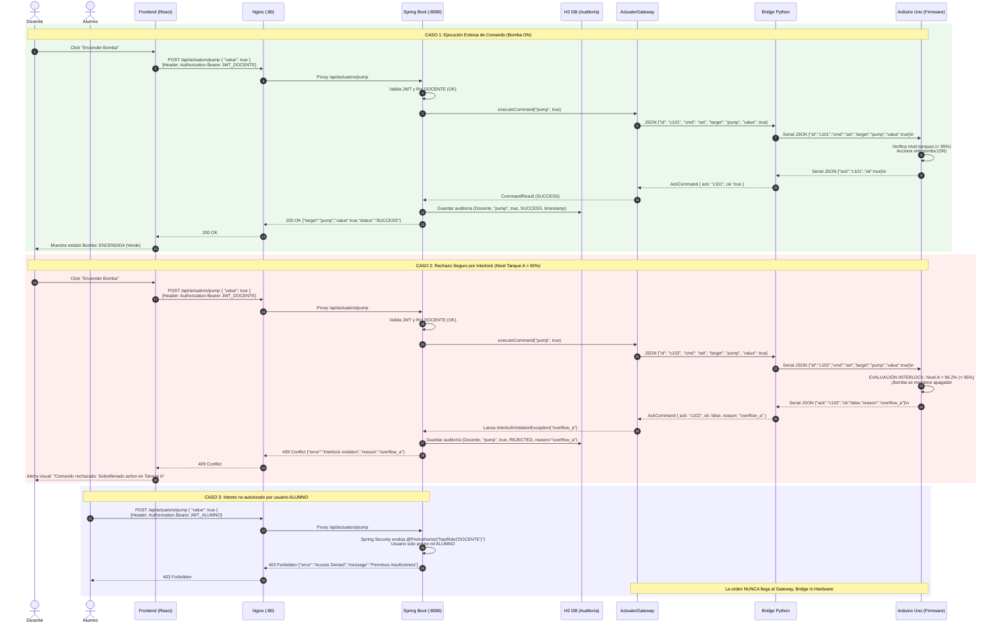

# Flujo de Comandos y Mecanismos de Seguridad (Interlocks)

**Proyecto**: Kit Didáctico de Tanques Interconectados (UTN FRSF / GITDA)  
**Compatibilidad**: Obsidian Markdown / CommonMark

---

## 1. Filosofía de Seguridad y Defensa en Profundidad

En aplicaciones de Industria 4.0 y control de procesos físicos, la seguridad de las personas y del equipo (*interlocks* y parada segura) prima sobre cualquier orden de operación.

El sistema implementa **cuatro capas de defensa en profundidad**:

1. **Capa 1 (Frontend)**: La interfaz gráfica adapta sus controles dinámicamente según el rol reportado por el token JWT. Los usuarios con rol `ALUMNO` tienen una vista exclusivamente de monitoreo; el panel de control de actuadores no se renderiza.
2. **Capa 2 (Control de Acceso en Backend)**: Los endpoints de mutación (`POST /api/actuators/{name}`) están custodiados por anotaciones `@PreAuthorize("hasRole('DOCENTE')")`. Cualquier solicitud de un usuario no docente es rechazada de inmediato con `403 Forbidden`.
3. **Capa 3 (Validación en ActuatorGateway)**: El backend valida que el comando cumpla con las reglas del dominio y con el estado de seguridad antes de despacharlo hacia el bridge.
4. **Capa 4 (Interlock en Hardware / Firmware)**: El Arduino Uno (y el simulador) contiene la lógica de corte duro autónomo. Si el nivel en cualquiera de los tanques supera el 95% (`overflow_a` u `overflow_b`), la bomba se detiene automáticamente por hardware y cualquier intento de encendido es rechazado con código de fallo específico (`reason: "overflow_a"`).

---

## 2. Diagrama de Secuencia de Comandos

El siguiente diagrama detalla los tres flujos fundamentales: ejecución exitosa, rechazo por interlock físico y bloqueo por autorización.

---

## 3. Watchdog de Bomba (60 s) y Reencendido Manual

### 3.1 Comportamiento vigente (decisión: reencendido manual)

El firmware limita el bombeo continuo a **60 s** (`PUMP_MAX_RUNTIME_MS` en `firmware/tanques/config.h`). Es un **tope duro** que actúa de forma autónoma en el Arduino Uno, sin depender del backend ni de la red:

1. Al recibir `set pump=true` aceptado, el firmware inicia el temporizador de bombeo continuo.
2. Si transcurren 60 s sin apagado, el firmware abre el relé y publica `alarms.pump_timeout = true`. La telemetría reporta `actuators.pump = false`.
3. El bridge, InfluxDB y el backend propagan la alarma sin cambios. La SPA la muestra de forma persistente: indicador de alarma en la barra superior ("Bomba Apagada por Watchdog (60 s)") y banner de advertencia en la vista de monitoreo.
4. El **docente reenciende a mano** con el botón "Encender Bomba". Un nuevo `set pump=true` aceptado reinicia el temporizador y limpia `pump_timeout`. Si hay un interlock activo (`overflow_a`, `overflow_b`, `sensor_fault`) o la telemetría está obsoleta (> 5 s, `telemetry_stale`), el encendido se rechaza como en cualquier otro caso.

No existe keep-alive: ni el backend ni la SPA reenvían `set pump=true` de forma automática. Cada ciclo de bombeo de más de 60 s es una decisión explícita del docente y queda registrado en la auditoría (sección 4).

### 3.2 Mejora futura (a evaluar): keep-alive automático del backend

Queda **descartada por ahora** y se evaluará después de calibrar el kit real. Diseño propuesto:

- El backend reenvía `set pump=true` cada **30 s** mientras el último estado pedido por el docente sea "encendida".
- El keep-alive tiene un **tope máximo de 5 minutos** de bombeo continuo total, configurable (por ejemplo `pump.keepalive.max-total-seconds`). Al alcanzarlo, el backend deja de reenviar y el watchdog del firmware corta la bomba.
- El keep-alive se **corta** ante cualquiera de estas condiciones:
  - interlock activo (`overflow_a`, `overflow_b` o `sensor_fault`);
  - telemetría obsoleta (`telemetry_stale`, > 5 s);
  - bridge caído (HTTP 503, `bridge_unavailable`).
- Cada reenvío se **registra en la auditoría** como un comando más, para trazabilidad completa.
- El watchdog de 60 s del firmware se mantiene como último recurso.

---

## 4. Registro de Auditoría

Cada comando procesado por el backend genera un registro inmutable en la tabla de auditoría en H2, accesible mediante `GET /api/audit` únicamente para el rol `DOCENTE`:

| Campo | Tipo | Ejemplo | Descripción |
|---|---|---|---|
| `id` | Long | `42` | Clave primaria autoincremental. |
| `timestamp` | Instant / UTC | `2026-10-14T23:45:00Z` | Momento exacto de recepción de la orden. |
| `username` | String | `"docente"` | Nombre del usuario autenticado vía JWT. |
| `target` | String | `"pump"` | Actuador involucrado. |
| `command_value` | String | `"true"` | Valor solicitado por el usuario. |
| `result` | String | `"SUCCESS"` \| `"REJECTED"` | Resultado de la operación. |
| `reason` | String | `"overflow_a"` \| `null` | Causa de rechazo en caso de falla o interlock. |
